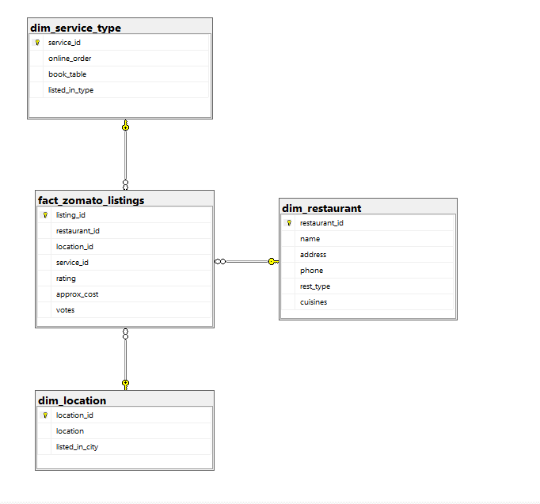

# Zomato Restaurants : End-to-End SQL Data Analysis
An end-to-end SQL portfolio project built in **Microsoft SQL Server (SSMS)** using the Zomato Restaurants dataset (51,000+ raw records). 
This project covers the full analytics workflow: 
raw data inspection, data cleaning & deduplication, Star Schema dimensional modeling, 
and business intelligence analysis.

---

## Project Overview
The goal of this project is to transform the raw flat file into a clean, normalized Star Schema data warehouse and answer key business questions around market concentration, pricing tiers, dining services, and top performing restaurants.
- **Tools Used:** MS SQL Server (T-SQL), SQL Server Management Studio (SSMS)
- **Dataset Source:** [Zomato Dataset (Kaggle)](https://www.kaggle.com/datasets/rajeshrampure/zomato-dataset)

---

## Repository Structure
```
zomato-sql-data-analysis/
├── 01.data_inspection/          # Initial profiling: sample rows, data types, distinct cost values
├── 02.data_cleaning/            # Validation scripts & creation of deduplicated master table:zomato_clean
├── 03.star_schema/              # DDL & DML scripts for 1 Fact table and 3 Dimension tables
├── 04.data_analysis/            # 5 business analysis SQL queries 
├── 05.results/                  # Exported CSV outputs for Q1–Q5
├── 06.images/                   # Star Schema ERD and SSMS import schema screenshots
└── README.md
```

---

## Data Inspection (`01.data_inspection/`)
Before cleaning the dataset, initial profiling was performed on the raw `zomato` table to identify data quality issues:
- **Sample Data Review:** Inspected sample rows to understand column structures and spot messy string formats (e.g., `'/5'` in ratings, commas in cost values).
- **Schema & Data Types:** Checked table metadata to identify numeric fields stored as text (`rate`, `approx_cost_for_two_people`, `votes`).
- **Distinct Value Profiling:** Audited distinct cost values and formatting inconsistencies to plan safe type conversions.

---

## Data Cleaning & Transformation (`02.data_cleaning/`)
Before modeling, the raw table `zomato` was validated and transformed into a clean master table `zomato_clean`:
- **Rating Standardization:** Stripped `'/5'` suffixes and safely converted values to `FLOAT` using `TRY_CAST`.
- **Cost & Votes Conversion:** Removed commas from `approx_cost_for_two_people` and cast both cost and `votes` to `INT`.
- **Deduplication:** Used `ROW_NUMBER() OVER (PARTITION BY name, address, listed_in_type ORDER BY votes DESC)` to retain only the most relevant, highest voted record per unique listing.

---

## Data Modeling: Star Schema (`03.star_schema/`)
To optimize analytical queries and eliminate redundancy, `zomato_clean` was modeled into a **Star Schema** consisting of:
- **Fact Table:** `fact_zomato_listings` (ratings, approximate cost for two, votes, and foreign keys)
- **Dimension Tables:**
  - `dim_restaurant` (restaurant name, address, phone, cuisines, online order & table booking flags)
  - `dim_location` (neighborhood location and listed city)
  - `dim_service_type` (restaurant type and dining category)



---

## Business Analysis (`04.data_analysis/`)

The following business questions were answered using joins, aggregations, `CASE` segmentation, and window functions on the Star Schema:

- **Q1:** Which are the top 10 food hubs by restaurant listings?  
  [q1_top_10_food_hubs.sql](04.data_analysis/q1_top_10_food_hubs.sql)

- **Q2:** How do online ordering and table booking availability impact average ratings and votes?  
  [q2_online_order_vs_booking.sql](04.data_analysis/q2_online_order_vs_booking.sql)

- **Q3:** How are restaurants distributed across price tiers?  
  [q3_price_tier_segmentation.sql](04.data_analysis/q3_price_tier_segmentation.sql)

- **Q4:** What are the top 10 most common restaurant types?  
  [q4_top_10_restaurant_types.sql](04.data_analysis/q4_top_10_restaurant_types.sql)

- **Q5:** Which are the highest-rated restaurants in each major location?  
  [q5_highest_rated_by_location.sql](04.data_analysis/q5_highest_rated_by_location.sql)

---

## Key SQL Techniques Demonstrated
- **Data Cleaning:** `TRY_CAST`, `REPLACE`, `LIKE` pattern filtering
- **Deduplication & Ranking:** CTEs (`WITH`), Window Functions (`ROW_NUMBER()`, `DENSE_RANK()`)
- **Data Modeling:** Primary/Foreign Key constraints, Surrogate Keys (`IDENTITY`), Star Schema design
- **Business Analytics:** Multi-table `JOIN`s, `CASE WHEN` segmentation, `GROUP BY` aggregations

---

## How to Run This Project
1. Download the raw dataset from [Kaggle](https://www.kaggle.com/datasets/rajeshrampure/zomato-dataset) and import it into MS SQL Server as `zomato`.
2. Execute the scripts in sequential order:
   - `01.data_inspection/` → `02.data_cleaning/` → `03.star_schema/` → `04.data_analysis/`
